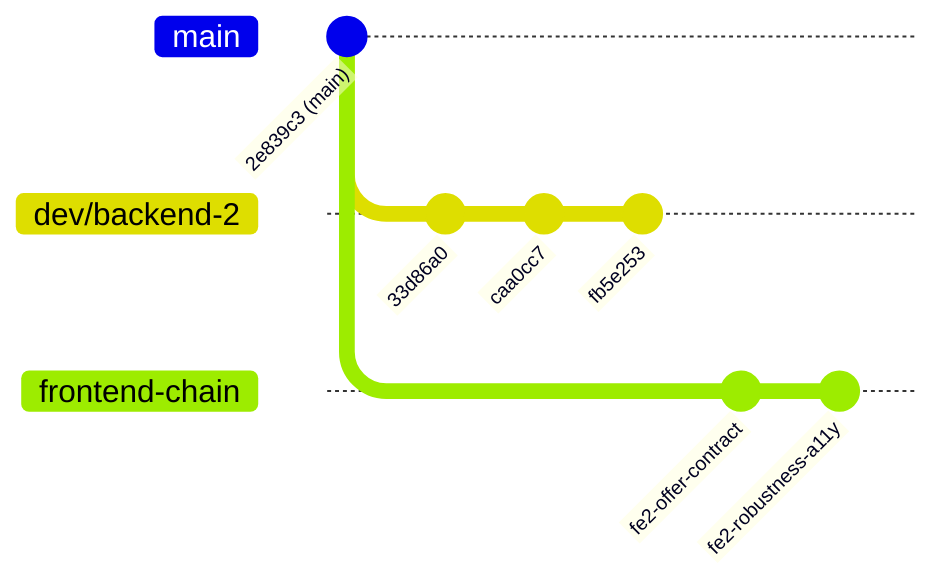

# Аудит ветки `dev/backend-2` — GoGlobe

> **Дата аудита:** 26 октября 2026 г.<br>
> **Ветка:** `dev/backend-2`<br>
> **Базовая ветка:** `origin/main` (коммит `2e839c3`)<br>  
> **Статус синхронизации:** Ветка синхронизирована с `origin/dev/backend-2`

---

## 1. Сводка (Executive Summary)

В ветке `dev/backend-2` полностью реализована серверная логика интеллектуального поискового агента GoGlobe:
* **Модуль 1:** Парсер пользовательских запросов (`parse_mock` на эвристиках + `parse_llm` на базе DeepSeek/OpenAI с автоматическим отказоустойчивым переключением).
* **Модуль 2:** Планировщик поиска (`build_search_plan`) и 6 специализированных инструментов агента.
* **Пайплайн:** Интеграция с оркестратором, SSE-трансляция этапов, честное обогащение объяснений климатическими данными и строгая валидация дат/бюджета.
* **Тестирование:** 34 теста из 34 проходят успешно (**100% pass**), статический анализ `ruff` без замечаний.

---

## 2. Метрики изменений

| Метрика | Значение |
| :--- | :--- |
| **Количество коммитов** | 3 коммита относительно `main` |
| **Изменённых файлов** | 12 файлов |
| **Строк добавлено / удалено** | `+1399` / `-69` |
| **Покрытие тестами** | 34 теста (`test_agent_modules.py` + `test_search_flow.py`) |
| **Время прогона тестов** | ~0.71 с |
| **Чистота кода (Ruff)** | `All checks passed!` |

---

## 3. История коммитов в ветке

```text
* fb5e253 (HEAD -> dev/backend-2, origin/dev/backend-2) feat(agent): enrich explanations with destination info, improve date parsing and config
* caa0cc7 (origin/feat/ai-layer, feat/ai-layer) feat(agent): robust parser, 6 architecture tools and extended test suite
* 33d86a0 feat(agent): implement Module 1 (LLM parser) and Module 2 (search planner & tools)
```

1. **`33d86a0`** — Базовая реализация Модуля 1 и Модуля 2:
   * Добавлены структуры инструментов в `backend/app/agent/tools.py`.
   * Каркас `parse_llm` и `build_search_plan`.
   * Первые 216 строк модульных тестов.
2. **`caa0cc7`** — Усиление устойчивости парсера и полный набор 6 инструментов:
   * Добавлены промпты в `backend/app/agent/prompts.py`.
   * 6 инструментов согласно архитектуре агента: `destination_search`, `flight_search`, `hotel_search`, `validate_combo`, `ranking_tool`, `explain_option`.
   * Расширение набора тестов до 522 строк. Ветка `origin/feat/ai-layer` зафиксирована на этом коммите.
3. **`fb5e253`** — Полировка, конфигурация и строгие правила:
   * Интеграция `destination_search` в объяснения (`explain.py`) и предупреждения (`warnings`).
   * Строгая обработка неполных дат: запрос с месяцем без конкретных дней не додумывается случайным числом, а корректно переводит статус в `needs_clarification`.
   * Поддержка `LLM_*` и `GOGLOBE_LLM_*` через `AliasChoices` в `config.py`.
   * Эталонные тесты запросов (Дубай в USD, Египет для семьи, Турция).

---

## 4. Детальный аудит компонентов

### 4.1. Конфигурация и окружение
* **`.env.example`**: добавлены переменные `LLM_API_KEY`, `LLM_BASE_URL` (по умолчанию `https://api.deepseek.com/v1`), `LLM_MODEL=deepseek-chat`, `USE_MOCK_AI=false`.
* **`backend/app/config.py`**:
  * Использован `pydantic.AliasChoices` для бесшовной работы как с префиксом `GOGLOBE_`, так и без него.
  * Флаг `use_mock_ai` для принудительного тестирования без расхода API-токенов.

### 4.2. Контракты и схемы
* **`backend/app/schemas/search.py`**:
  * Модель `ParsedQuery` расширена полем `warnings: list[str] = Field(default_factory=list)`. Предупреждения парсера пробрасываются в итоговый `SearchResponse.warnings`.

### 4.3. Парсер запросов (Модуль 1)
* **`backend/app/agent/parser.py`**:
  * `parse_mock`: эвристический разбор регулярными выражениями: направления, длительность, диапазоны дат («с 5 по 10 ноября»), бюджеты с валютами (рубли/USD), количество путешественников (взрослые + дети), пожелания (`sea_view`, `direct_flight`, `all_inclusive`).
  * `parse_llm`: запрос к LLM в формате JSON schema.
  * Фолбэк: если `llm_api_key` пустой, сеть недоступна или произошла ошибка парсинга — выполняется прозрачный откат на `parse_mock`.
  * `missing_question`: возвращает конкретизирующий вопрос, если не хватает критичных параметров (направление, даты).

### 4.4. Инструменты и планировщик (Модуль 2)
* **`backend/app/agent/tools.py`**:
  * `destination_search`: локальная база знаний по сезонам и климату (Турция, ОАЭ, Египет, Таиланд).
  * `flight_search` & `hotel_search`: вызов провайдеров с изоляцией исключений (`ProviderError` переводится в `warnings`, не роняя процесс поиска).
  * `validate_combo`: фильтрация по бюджету, доступности и прямому рейсу.
  * `ranking_tool`: прозрачный скоринг 0..1 (учитывает рейтинг отеля, попадание в бюджет, наличие прямого рейса и соответствие пожеланиям).
  * `explain_option`: генерация причин выбора (why, pros, cons, sources, confidence).
  * `build_search_plan`: строит граф шагов `SearchExecutionPlan` с привязкой к стадиям SSE-событий.

### 4.5. Оркестратор поиска
* **`backend/app/agent/orchestrator.py`**:
  * Последовательность шагов:
    1. Парсинг (`parsing`) $\to$ генерация уточняющего вопроса при нехватке данных (`needs_clarification`).
    2. Построение плана $\to$ отправка SSE-событий клиенту.
    3. Вызов `destination_search`, `flight_search`, `hotel_search`.
    4. Валидация комбинаций перелёт + отель под бюджет.
    5. Ранжирование по убыванию `score` и генерация объяснений.
    6. Формирование ответа со статусами `ok`, `partial` (если есть офферы, но были предупреждения), `empty` или `needs_clarification`.

### 4.6. Тесты
* **`backend/tests/test_agent_modules.py`** (30 тестов):
  * Тесты парсера на даты, диапазоны, валюты, пожелания, состав семьи.
  * Тесты LLM-парсера и отказоустойчивости при сбоях сети/невалидном JSON.
  * Тесты всех 6 инструментов и планировщика поиска.
  * Интеграционные тесты через `TestClient(app)`: полный цикл поиска, проверка стадий SSE, убывающий порядок скоринга, эталонные сценарии.
* **`backend/tests/test_search_flow.py`** (4 теста):
  * Сквозные тесты API эндпоинтов `/api/search` и `/api/search/{id}/events`.

---

## 5. Анализ совместимости со смежными ветками



1. **Фронтенд (`origin/dev/frontend-2`, `origin/fix/fe2-robustness-a11y`)**:
   * **Полная совместимость:** Фронтенд ожидает поля `explanation` (`why`, `pros`, `cons`, `sources`, `confidence`), `data_freshness`, `booking_url`, `warnings`, статусы `ok`, `needs_clarification`, `partial`, `empty`. Бэкенд возвращает структуры строго по контракту.
2. **Ветка `origin/dev/backend-1`**:
   * В ней закоммичена документация OpenAPI v0.3 в `docs/api/v0.3/`. Код бэкенда не затронут, пересечений файлов нет.
3. **Ветка `origin/feat/ai-layer`**:
   * Является промежуточным срезом ветки `dev/backend-2` на коммите `caa0cc7`. При слиянии `dev/backend-2` ветка `feat/ai-layer` может быть закрыта/удалена без потери данных.

---

## 6. Замечания и подготовка к компоновке

### 6.1. Неотслеживаемая папка в рабочей директории
* В корне обнаружена папка `"GoGlobe ненужный/"`, содержащая вложенный `.git` и старый файл `README.md`.
* **Действие:** удалить перед формированием коммитов/сборки:
  ```powershell
  Remove-Item -Recurse -Force "GoGlobe ненужный"
  ```

---

## 7. Варианты компоновки ветки для слияния

### Вариант 1: Squash Merge (Рекомендуется для PR в `main`)
Позволяет внести всю функциональность одним атомарным коммитом с чистой историей:
* **Заголовок:** `feat(backend): AI search agent (LLM parser, 6 tools, planner, scoring & tests)`
* **Тело коммита:**
  ```text
  - Implement Module 1: robust query parser with parse_mock and parse_llm fallback
  - Implement Module 2: search planner (build_search_plan) and 6 architecture tools
  - Add destination knowledge base with seasonal & weather info
  - Integrate orchestrator with SSE events streaming and validation
  - Add comprehensive test suite with 34 tests covering edge cases and reference queries
  ```

### Вариант 2: Логическое разделение на 2 коммита (при Rebase)
Если команда требует разделять конфигурацию и бизнес-логику:
1. `feat(config): add LLM provider settings and environment variables` (`.env.example`, `backend/app/config.py`)
2. `feat(agent): implement search agent, 6 tools, search planner and tests` (все файлы `app/agent/*`, `schemas/search.py`, `tests/*`)

### Вариант 3: Оставить 3 существующих коммита
Коммиты уже оформлены по стандарту Conventional Commits и логически самодостаточны. При создании PR можно использовать стандартный merge commit без squash.

---

## 8. Чеклист готовности (Definition of Done)

- [x] Все 34 теста проходят успешно (`pytest`).
- [x] Статический анализ `ruff` не выдаёт ошибок и предупреждений.
- [x] API-контракт полностью совпадает с ожиданиями фронтенда.
- [x] Изоляция сбоев внешних провайдеров (таймауты не ломают общий поиск).
- [x] Безопасный фолбэк с LLM на mock-парсер без падений.
- [ ] Очищена посторонняя папка `"GoGlobe ненужный/"`.
