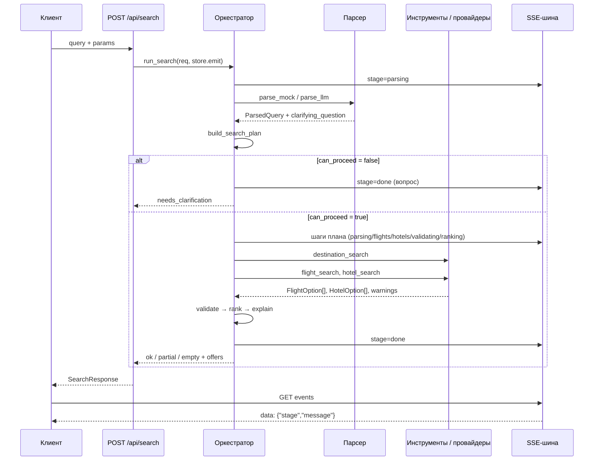

# Полный отчёт о работе: AI-агент GoGlobe (Backend №2)

> **Подпись:** Backend №2 — AI-агент · ветка `dev/backend-2` · HEAD `fb5e253`
> **Дата:** 27 октября 2026 г.
> **Назначение:** baseline-документ для тестов на падения (negative / failure testing)

---

## 0. Паспорт отчёта

| Параметр | Значение |
|---|---|
| Автор коммитов | `Leonard1L` (`lprofi52@gmail.com`) |
| Роль | **Backend №2 — AI-агент** |
| Ветка | **`dev/backend-2`** |
| Базовая ветка | `origin/main` @ `2e839c3` |
| HEAD ветки | `fb5e253` (локальная = `origin/dev/backend-2`) |
| Коммитов относительно `main` | 3 |
| Изменённых файлов | 12 |
| Дифф | `+1399` / `−69` |
| Тесты | **34 / 34 passed** (`pytest`, 1.31 с) |
| Статический анализ | **`ruff check .` — All checks passed!** |
| Локальное окружение прогона | Python 3.14.2, pydantic 2.14.1, fastapi 0.161.1, httpx 0.28.1 |
| CI | Python 3.12, `ruff check .` + `pytest -q` |
| Дата отчёта | 27.10.2026 |

**Связанные документы:** [`BRANCH_AUDIT.md`](BRANCH_AUDIT.md) (аудит ветки и варианты слияния, 26.10.2026), [`docs/api-contract.md`](docs/api-contract.md), [`docs/demo-scenario.md`](docs/demo-scenario.md), [`README.md`](README.md).

---

## 1. Краткое резюме

В ветке `dev/backend-2` реализован серверный AI-слой GoGlobe: разбор естественного запроса (эвристики + LLM с безопасным фолбэком), планировщик поиска, 6 инструментов агента, оркестратор полного цикла, валидация бюджета/дат, прозрачное ранжирование и объяснения, а также набор из 34 тестов.

**Что сделано:**

- **Модуль 1** — `parse_mock` (детерминированные эвристики) и `parse_llm` (DeepSeek/OpenAI-совместимый API, JSON mode, timeout 10 с) с автоматическим откатом на эвристики при любой ошибке.
- **Модуль 2** — 6 инструментов по архитектуре (`destination_search`, `flight_search`, `hotel_search`, `validation`, `ranking`, `explain`) и планировщик `build_search_plan` с привязкой шагов к SSE-стадиям.
- **Оркестратор** — 6 шагов, 5 статусов ответа, изоляция сбоев провайдеров, топ-10 офферов, SSE-события.
- **Конфигурация** — `LLM_*` и `GOGLOBE_LLM_*` через `AliasChoices`, флаг `USE_MOCK_AI`.
- **Контракт** — служебное поле `ParsedQuery.warnings`, проброс предупреждений парсера.
- **Тесты** — 34 теста: парсер, баг-регрессии, инструменты, планировщик, оркестратор, эталонные запросы, сквозной SSE/API.

**Вердикт:** функциональное ядро готово к демонстрации, но **не готово к произвольным запросам**. При прогоне на падения найдены **1 дефект P0, 5 дефектов P1, 7 дефектов P2 и 6 замечаний P3**. Главные:

1. **P0:** запрос без числа путешественников («Турция с 5 по 10 ноября, до 120000», «…с детьми», `travelers=0`) падает в `status=error` из-за `TypeError` в mock-провайдере.
2. **P1:** невалидный день в диапазоне вида «с 31 по 32 ноября» (и невалидная дата в `params.dates`) даёт `status=error` вместо уточнения/422.
3. **P1:** статус `ok` **недостижим** — сезонность и температура попадают в `warnings`, поэтому любой успешный поиск возвращает `partial`.
4. **P1:** повторный `search_id` отдаёт в SSE события первого прогона; неизвестный `search_id` подвешивает SSE-поток навсегда.

Подробная матрица — в разделе 7.

---

## 2. Роль, ветка и границы работы

### 2.1. Роль по командной матрице

| Роль | Ветка | Зона ответственности |
|---|---|---|
| **Backend №2** | **`dev/backend-2`** | AI-агент: разбор запроса, оркестрация инструментов, валидация бюджета, ранжирование, объяснения, тесты на демо-запросах |

Формулировка взята из [`README.md`](README.md), раздел «Команда и зоны ответственности».

### 2.2. Что входит в отчёт

- `backend/app/agent/*` — парсер, инструменты, планировщик, оркестратор, объяснения, ранжирование, валидация, промпты.
- `backend/app/config.py` — LLM-настройки и алиасы переменных.
- `backend/app/schemas/search.py` — единственное добавленное поле `ParsedQuery.warnings`.
- `backend/tests/test_agent_modules.py`, `backend/tests/test_search_flow.py`.
- `.env.example` — переменные LLM.

### 2.3. Что не входит

- HTTP-слой, SSE-роут, схемы контракта, провайдеры и кэш — зона **Backend №1** (использованы как база, не переписывались).
- Frontend-ветки (`dev/frontend-1`, `dev/frontend-2` и feat-ветки) — в отчёт не включены.
- Документация API и демо-сценарий — зона Backend №1 / команды.
- Коммит `cc08d06` «Update README.md» (17.10, аккаунт `Leonard-1L`) — вне текущей ветки, в метрики не включён.

---

## 3. История работ

### 3.1. Хронология проекта

| Дата | Событие |
|---|---|
| 17.10.2026 | `c7dfe2c` Initial commit; `cc08d06` README |
| 18.10.2026 | `56001da` bootstrap monorepo (FastAPI + React + контракт v0 + CI) |
| 20.10.2026 | `e6a5cc6` / `adb216a` документация API v0.3 (Backend №1) |
| 22.10.2026 | `2e839c3` frontend-цепочка в `main` (Claude / Frontend) |
| **23.10.2026** | **`33d86a0`, `caa0cc7` — Модуль 1 и Модуль 2 (Backend №2)** |
| **25.10.2026** | **`fb5e253` — обогащение объяснений, строгие даты, конфигурация** |
| 26.10.2026 | `BRANCH_AUDIT.md` — аудит ветки |
| 27.10.2026 | Настоящий отчёт и прогон тестов на падения |

### 3.2. Коммиты ветки

| # | Коммит | Дата | Файлов | Строк | Суть |
|---|---|---|---|---|---|
| 1 | `33d86a0` | 23.10 12:54 | 9 | `+732 / −55` | Каркас Модуля 1 (LLM-парсер) и Модуля 2 (планировщик + инструменты), первые 216 строк тестов |
| 2 | `caa0cc7` | 23.10 13:21 | 5 | `+522 / −177` | Устойчивый парсер, 6 инструментов по архитектуре, расширение тестов |
| 3 | `fb5e253` | 25.10 17:15 | 8 | `+358 / −50` | Сезонность/температура в объяснениях, строгие правила дат, `AliasChoices`, эталонные запросы |

Суммы по коммитам включают перезаписи; итоговый уникальный дифф к `main` — **12 файлов, `+1399 / −69`**.

### 3.3. Что именно менялось

**`33d86a0` — «implement Module 1 (LLM parser) and Module 2 (search planner & tools)»**

- `parser.py`: `parse_llm`, `extract_json_payload`, преобразование JSON LLM → `ParsedQuery`, фолбэк.
- `tools.py`: реестр `AgentToolName`, `SearchStage`, `PlannedToolStep`, `build_search_plan`.
- `orchestrator.py`: интеграция парсера и плана в общий пайплайн.
- `prompts.py`: системные промпты парсера и объяснений.
- `test_agent_modules.py`: первые 216 строк тестов.

**`caa0cc7` — «robust parser, 6 architecture tools and extended test suite»**

- 6 инструментов: `destination_search`, `flight_search`, `hotel_search`, `validate_combo`, `ranking_tool`, `explain_option`.
- `destination_search` с локальной базой сезонности/климата.
- Изоляция `ProviderError` → `warnings`, без падения поиска.
- Ужесточение `missing_question`: `travelers` перестал быть обязательным (важный побочный эффект — см. F-01).
- Расширение тестов до 344 строк.

**`fb5e253` — «enrich explanations with destination info, improve date parsing and config»**

- `explain.py`: сезонность и температура в `pros`; честный `cons` при `available=None`.
- `parser.py`: разбор диапазонов «с 5 по 10 ноября», отказ от угадывания даты при указанном только месяце.
- `config.py`: `AliasChoices` для `LLM_API_KEY` / `GOGLOBE_LLM_API_KEY` и остальных LLM-переменных.
- `schemas/search.py`: `ParsedQuery.warnings`.
- `orchestrator.py`: проброс предупреждений парсера, сезонности и температуры в `warnings`.
- Эталонные тесты: Дубай в USD, Египет для семьи, Турция.

---

## 4. Реализованная функциональность

### 4.1. Модуль 1 — анализ запроса

Файл: [`backend/app/agent/parser.py`](backend/app/agent/parser.py) (343 строки).

| Возможность | Реализация |
|---|---|
| Направление | 19 основ: Турция, Анталья, Стамбул, Сочи, Италия, Рим, Бали, Дубай, ОАЭ, Египет, Хургада, Шарм, Таиланд, Пхукет, Мальдивы, Грузия, Тбилиси, Армения, Ереван |
| Длительность | «5 дней/ночей», «на неделю» = 7, «на две недели» = 14, «на выходные» = 3 |
| Бюджет | «до / бюджет / около / в пределах», суффиксы `к`, `тыс`, валюты `₽`, `руб`, `$`, `€`, `usd`, `eur`, пробелы и `&nbsp;` в числе |
| Путешественники | «вдвоём / на двоих / пара / с женой» = 2, «один / соло» = 1, «втроём / с ребёнком» = 3, «вчетвером / компания» = 4, «N человек / взрослых» |
| Пожелания | `sea_view`, `direct_flight`, `all_inclusive`, `breakfast`, `pool`, `quiet`, `city_center`, `spa` |
| Даты | Точный диапазон «с 10 по 15 ноября», «10-15 ноября»; месяц без числа — **не угадывается** |
| Приоритет формы | `params.dates`, `params.budget`, `params.travelers` перекрывают текст; `wishes` объединяются |
| Уточняющий вопрос | `missing_question`: нет направления и дат → общий вопрос; нет направления; нет дат |

**Принцип честности:** если в запросе нет конкретного дня, `dates` остаётся `None`, добавляется предупреждение, агент задаёт уточняющий вопрос. Это закрывает баг «выдуманное 10-е число».

#### 4.1.1. LLM-парсер и фолбэк

`parse_llm(query, params, timeout_sec=10.0)`:

- `POST {LLM_BASE_URL}/chat/completions`, `response_format={"type": "json_object"}`, `temperature=0`.
- Модель по умолчанию — `deepseek-chat`.
- `extract_json_payload` снимает markdown-обёртку ```json и умеет вырезать JSON из текста.
- `_llm_json_to_parsed_query` приводит ответ к контракту `ParsedQuery`.
- `parse_user_query` — алиас для обратной совместимости.

| Ситуация | Поведение |
|---|---|
| Нет `LLM_API_KEY` | `parse_mock` |
| `USE_MOCK_AI=true` | `parse_mock` |
| Timeout / network error / 4xx / 5xx | `logger.warning` + `parse_mock` |
| Невалидный JSON / markdown | Попытка извлечь JSON; при неудаче — `parse_mock` |
| В ответе нет `choices` / полей | Исключение ловится → `parse_mock` |
| `dates.from` + `duration_days` с битой датой | Исключение внутри `try` → `parse_mock` |
| `dates.from` и `dates.to` — обе битые строки | **Не ловится**: `DateRange` принимает любые строки, падение уходит downstream (F-13) |

### 4.2. Модуль 2 — инструменты и планировщик

Файл: [`backend/app/agent/tools.py`](backend/app/agent/tools.py) (309 строк).

| # | Инструмент | Функция | Что делает |
|---|---|---|---|
| 1 | Destination Search | `destination_search` | Сезонность, температура, достопримечательности; база: Турция, Сочи, Дубай, Египет, Таиланд + generic-ответ |
| 2 | Flight Search | `flight_search` | Вызов провайдера, `ProviderError` → warning + `[]` |
| 3 | Hotel Search | `hotel_search` | Вызов провайдера, `ProviderError` → warning + `[]` |
| 4 | Validation | `validate_combo` | Прямой рейс, доступность, бюджет; возвращает `(bool, total)` |
| 5 | Ranking | `ranking_tool` | Прозрачный скоринг 0..1: рейтинг 0.35, бюджет 0.30, море 0.20, прямой рейс 0.15 |
| 6 | Explain | `explain_option` | `why`, `pros`, `cons`, `sources`, `confidence` только из фактов |

**Планировщик `build_search_plan`:**

- Если есть уточняющий вопрос → `can_proceed=False`, шагов нет, ответ `needs_clarification`.
- Иначе 5 шагов: `destination_search → flight_search → hotel_search → validation → ranking`.
- Каждый шаг привязан к SSE-стадии: `parsing`, `flights`, `hotels`, `validating`, `ranking`.
- В `filters` передаются направление, `direct_only`, `travelers or 1`, пожелания, лимит бюджета.

### 4.3. Оркестратор

Файл: [`backend/app/agent/orchestrator.py`](backend/app/agent/orchestrator.py) (148 строк).

1. `parsing` — `parse_llm` при `GOGLOBE_PARSER=llm`, иначе `parse_mock`.
2. `build_search_plan` и публикация его шагов как SSE-статусов; при `can_proceed=False` — `done` с вопросом и `needs_clarification`.
3. `destination_search`, затем `flight_search`, `hotel_search` (последовательно).
4. Валидация: фильтр `available is not False`, бюджет, `direct_flight`.
5. Ранжирование, объяснения, сортировка по `score` убыванию, топ-10.
6. Статус и ответ: `ok` / `partial` / `empty` / `needs_clarification`; `error` — на уровне API.

**Особенности:**

- `mock_stage_delay=0.4` — пауза между стадиями только для mock-провайдеров.
- `data_freshness` — минимум из `fetched_at` перелёта и отеля.
- `booking_url` берётся из отеля.
- Все предупреждения парсера, сезонности, температуры и провайдеров складываются в `warnings`.

### 4.4. Конфигурация

Файл: [`backend/app/config.py`](backend/app/config.py) (44 строки).

| Переменная | По умолчанию | Назначение |
|---|---|---|
| `GOGLOBE_ENV` | `dev` | Окружение |
| `GOGLOBE_PROVIDERS` | `mock` | `mock` / `live` |
| `GOGLOBE_PARSER` | `mock` | `mock` / `llm` |
| `GOGLOBE_CORS_ORIGINS` | `http://localhost:5173` | CORS |
| `GOGLOBE_MOCK_STAGE_DELAY` | `0.4` | Пауза между SSE-стадиями |
| `LLM_API_KEY` / `GOGLOBE_LLM_API_KEY` | `""` | Ключ провайдера |
| `LLM_BASE_URL` / `GOGLOBE_LLM_BASE_URL` | `https://api.deepseek.com/v1` | Base URL |
| `LLM_MODEL` / `GOGLOBE_LLM_MODEL` | `deepseek-chat` | Модель |
| `USE_MOCK_AI` / `GOGLOBE_USE_MOCK_AI` | `false` | Принудительный mock-парсер |

Секреты хранятся только в `.env` (в `.gitignore`); шаблон — [`.env.example`](.env.example).

### 4.5. Контракт API

Изменение схемы одно: в `ParsedQuery` добавлено `warnings: list[str]` ([`backend/app/schemas/search.py`](backend/app/schemas/search.py)). Остальные поля v0 не менялись.

| Статус | Условие в коде | Фактически |
|---|---|---|
| `ok` | есть офферы и `warnings` пуст | **Недостижим** (F-04) |
| `needs_clarification` | `plan.can_proceed=False` | Работает |
| `partial` | есть офферы и `warnings` непуст | Все успешные поиски |
| `empty` | офферов нет | Работает |
| `error` | исключение в `run_search`, поймано API | Работает, но текст исключения уходит клиенту |

SSE-стадии: `parsing → flights → hotels → validating → ranking → done` (+ `error` на уровне API).

### 4.6. Тесты

| Файл | Тестов | Строк | Покрытие |
|---|---|---|---|
| [`backend/tests/test_agent_modules.py`](backend/tests/test_agent_modules.py) | 30 | 586 | Парсер, баг-регрессии, LLM-фолбэк, инструменты, планировщик, оркестратор, эталонные запросы |
| [`backend/tests/test_search_flow.py`](backend/tests/test_search_flow.py) | 4 | 44 | Сквозной демо-запрос, уточнение, «пусто», SSE + сохранённый результат |
| **Итого** | **34** | **630** | |

**Группы:**

- Парсер и JSON — 9 тестов.
- Баг-регрессии (даты, «май» vs «Мальдивы», «март» vs «маршрут», LLM-фолбэк) — 8 тестов.
- Инструменты и планировщик — 6 тестов.
- Оркестратор и SSE — 3 теста.
- Ранжирование и эталонные запросы — 3 теста.
- Destination → warnings/explanation — 1 тест.
- Сквозной API — 4 теста.

---

## 5. Архитектура и поток выполнения



**Ключевые инварианты:**

- Все цены, наличие и характеристики — только из ответов инструментов.
- Нет данных — `None`, а не выдуманное значение.
- Сбой провайдера не роняет поиск: `ProviderError` → warning.
- Сбой LLM не роняет парсер: откат на `parse_mock`.
- Максимум 10 офферов в ответе.

---

## 6. Как запустить и проверить

### 6.1. Windows / PowerShell

```powershell
cd "C:\My_programms\Antigravity IDE\Программы\GoGlobe\backend"

# тесты
.\.venv\Scripts\python.exe -m pytest -q

# линт
.\.venv\Scripts\python.exe -m ruff check .

# сервер
.\.venv\Scripts\uvicorn.exe app.main:app --reload --port 8000
```

### 6.2. Linux / macOS / CI

```bash
cd backend
python -m pytest -q
ruff check .
uvicorn app.main:app --reload --port 8000
```

### 6.3. Результат прогона 27.10.2026

```text
34 passed, 2 warnings in 1.31s
All checks passed!
```

Два предупреждения не относятся к продукту:

- `StarletteDeprecationWarning` про `httpx` в `TestClient`;
- `PytestCacheWarning` из-за ACL `.pytest_cache` в Windows-песочнице.

### 6.4. Ручная проверка API

```powershell
$body = @{ query = "Хочу на 5 дней в Турцию с 5 по 10 ноября, на двоих, бюджет до 120 000 рублей" } | ConvertTo-Json
Invoke-RestMethod -Method Post -Uri http://localhost:8000/api/search `
  -ContentType "application/json; charset=utf-8" -Body ([Text.Encoding]::UTF8.GetBytes($body))
```

---

## 7. Тесты на падения

### 7.1. Что считается падением

1. HTTP 5xx или необработанное исключение.
2. `status="error"` на валидном пользовательском вводе.
3. Зависание SSE/HTTP дольше разумного таймаута.
4. Некорректные данные в ответе: отрицательная цена, `from > to`, пустой `data_freshness`.
5. Нарушение контракта: недостижимый статус, потеря предупреждений.
6. Утечка внутренней информации (текст исключения, стек).

Все проверки ниже выполнены **27.10.2026 на HEAD `fb5e253`**, если не указано «по коду».

### 7.2. Сводка

| Severity | Кол-во | Идентификаторы |
|---|---|---|
| **P0 — критично** | 1 | F-01 |
| **P1 — исправить до демо** | 5 | F-02, F-03, F-04, F-05, F-06 |
| **P2 — исправить до PR** | 7 | F-07…F-13 |
| **P3 — замечания** | 6 | F-14…F-19 |

### 7.3. Матрица сценариев

| ID | Сценарий | Вход | Ожидаемо | Факт | Severity |
|---|---|---|---|---|---|
| **F-01** | Нет числа путешественников | `{"query":"Турция с 5 по 10 ноября, до 120000"}` | Поиск на 1 человека **или** уточняющий вопрос | `200`, `status=error`, `warnings[0]="Внутренняя ошибка: unsupported operand type(s) for *: 'int' and 'NoneType'"` | **P0** |
| **F-01a** | То же, «с детьми» | `{"query":"Турция с 5 по 10 ноября с детьми"}` | 1 или уточнение | `status=error`, тот же `TypeError` | P0 |
| **F-01b** | `travelers=0` | `params:{"travelers":0}` | 422 или 1 | `status=error`, тот же `TypeError` (`0` falsy → `None`) | P0 |
| **F-02** | Невалидный календарный день в тексте | `{"query":"Турция с 31 по 32 ноября на двоих"}` | Уточнение или 422 | `200`, `status=error`, `"day 31 must be in range 1..30 for month 11"` | P1 |
| **F-03** | Невалидная дата в `params` | `dates:{"from":"2026-02-30","to":"2026-03-05"}`, `"Турция на двоих"` | 422 (валидация схемы) | `200`, `status=error`, `"day 30 must be in range 1..28 for month 2"` | P1 |
| **F-04** | `ok` недостижим | Демо-запрос | `status=ok`, `warnings=[]` | `status=partial`, 2 информационных warning (сезонность, температура) | P1 |
| **F-05** | Повторный `search_id` | Два POST с `search_id="dup"`, затем GET events | События нового прогона | SSE отдаёт **11 событий первого прогона** и завершается на первом `done`; события второго недоступны | P1 |
| **F-06** | SSE для неизвестного id | `GET /api/search/nope/events` | 404 или `error`-событие | Поток висит: `store.stream` ждёт `Condition` бесконечно | P1 |
| **F-07** | Отрицательное число путешественников | `params:{"travelers":-2}` | 422 | `status=partial`, 8 офферов, `flight.price.amount = -18000`, `total = 31000` | P2 |
| **F-08** | Перевёрнутые даты | `"Турция с 10 по 5 ноября на двоих"` | 422 или уточнение | `status=partial`; `dates.from=2026-11-10`, `to=2026-11-05`, `duration_days=1`, 8 офферов с заниженной суммой | P2 |
| **F-09** | Валюта бюджета игнорируется | `"Турция … бюджет 100000 долларов"` | Лимит в USD либо конвертация | `status=partial`, в `pros`: `"Итого 26 000 ₽ при лимите 100 000 ₽"`; при `3000 USD` — `empty`, хотя сумма в RUB проходит | P2 |
| **F-10** | Утечка текста исключения | Любой сбой `run_search` | Общее сообщение + лог | В `warnings` уходит `str(e)`; в `api/search.py` нет `logger.exception` | P2 |
| **F-11** | Хранилище in-memory | Рестарт, 2+ воркера | Сохранность/общий доступ | `store.results` и `store.events` теряются при рестарте; при нескольких воркерах SSE и `GET /search/{id}` расходятся | P2 |
| **F-12** | Направление вне whitelist | `"Япония с 5 по 10 ноября на двоих"` | Поиск или «нет данных» | `needs_clarification`: «Какую страну или город вы рассматриваете для поездки?» — направление проигнорировано | P2 |
| **F-13** | LLM вернул невалидные даты | `dates.from="10.11.2026"`, `dates.to="15.11.2026"` | Уточнение/фолбэк | `DateRange` принимает строки; downstream `date.fromisoformat` → `status=error` (по коду, воспроизводится через `params`) | P2 |
| **F-14** | Потеря warning при уточнении | `"5 дней в Турцию в ноябре, на двоих"` | Warning в топ-левел `warnings` | `warnings=[]`; сообщение только в `parsed.warnings` | P3 |
| **F-15** | Деление на ноль в ranking | `ranking_tool(..., budget=Money(amount=0))` | 0 или безопасный score | `ZeroDivisionError`; E2E не достигается из-за фильтра бюджета | P3 |
| **F-16** | Пустой `data_freshness` | Провайдер вернул `fetched_at=""` у отеля | Валидный ISO | `min("", iso) = ""` → пустая строка в ответе | P3 |
| **F-17** | Ложные срабатывания regex | `"Турция на 5 дней, мороз"`, `"…майонез"` | Без `sea_view` / без месяца | `"мороз"` содержит `"мор"` → `sea_view`; `"майонез"` содержит `"май"` → warning о месяце | P3 |
| **F-18** | Нет лимита длины запроса | 10 000+ символов | 422 или лимит | `200`, `partial`, 8 офферов; ограничения нет | P3 |
| **F-19** | Переход года | `"Турция с 30 декабря по 2 января на двоих"` | Даты 30.12–02.01 | `dates=None` → уточнение (честно, но UX-пробел) | P3 |

Примечание к F-14: текст предупреждения ещё и грамматически некорректен — «Месяц (ноябре) указан»; для мая — «Месяц (мае) указан».

### 7.4. Сценарии, которые уже отработали корректно

| ID | Сценарий | Проверка |
|---|---|---|
| G-01 | Нет `LLM_API_KEY` | `parse_llm` → `parse_mock` (тест `test_bug1_llm_fallback_on_empty_key`) |
| G-02 | LLM недоступен (network error) | Фолбэк на mock (тест `test_bug1_llm_fallback_on_llm_crash`) |
| G-03 | LLM вернул markdown/мусор | `extract_json_payload` / фолбэк (тест + код) |
| G-04 | `ProviderError` перелётов/отелей | Warning + пустой список, поиск продолжается (код) |
| G-05 | Невозможный бюджет | `status=empty` + совет (тест) |
| G-06 | Нет направления или дат | `needs_clarification` (тесты) |
| G-07 | Пустой `query` | HTTP 422 (проверено) |
| G-08 | Неизвестный `search_id` в `GET /search/{id}` | HTTP 404 (проверено) |
| G-09 | SSE-стадии | `parsing → flights → hotels → validating → ranking → done` (тест) |
| G-10 | Порядок ранжирования | `score` по убыванию (тест) |
| G-11 | Фильтр прямых рейсов | Остаются только `direct=True` (тест) |
| G-12 | Ограничение выдачи | Не более 10 офферов (код) |
| G-13 | Уточняющий вопрос вместо догадки | Месяц без числа → вопрос (тесты) |

### 7.5. Приоритетный план исправлений

| Приоритет | ID | Действие | Точка в коде |
|---|---|---|---|
| **P0** | F-01 | Подставлять `travelers or 1` при вызове провайдеров; нормализовать в парсере | `orchestrator.py:86-92` |
| **P1** | F-02 | Ловить `ValueError` при `date(...)`, переводить в warning + `dates=None` | `parser.py:169-183` |
| **P1** | F-03 | Валидаторы `DateRange`: ISO-формат и `from <= to`; `travelers: ge=1` | `schemas/search.py:19-30` |
| **P1** | F-04 | Разделить `info` и `warnings`; сезонность/температуру не считать деградацией | `orchestrator.py:79-83`, `140-142` |
| **P1** | F-05 | Очищать события при новом поиске с тем же `search_id` или запрещать переиспользование | `cache/store.py`, `api/search.py` |
| **P1** | F-06 | 404/`error`-событие и таймаут для неизвестного `search_id` | `cache/store.py:43-54` |
| **P2** | F-07, F-08 | Валидация `travelers >= 1`, `dates.from <= dates.to` | `schemas/search.py`, `validation.py:9-10` |
| **P2** | F-09 | Конвертация валют или сравнение только одинаковых валют; символ валюты в `pros` | `validation.py:20-21`, `explain.py:19` |
| **P2** | F-10 | `logger.exception` + общее сообщение клиенту | `api/search.py:19-29` |
| **P2** | F-11 | TTL/лимит хранилища; зафиксировать single-worker или вынести в Redis | `cache/store.py` |
| **P2** | F-12 | Расширить `_DEST` или не блокировать поиск для неизвестного направления | `parser.py:43-63`, `212-221` |
| **P3** | F-14…F-19 | Warning в топ-левел, guard в ranking, `data_freshness`, границы regex, `max_length` | см. матрицу |

Пример минимальной правки для F-01:

```python
# backend/app/agent/orchestrator.py, вызовы flight_search/hotel_search
travelers = parsed.travelers or 1
flights = await flight_search(flights_p, parsed.destination, parsed.dates, travelers, warnings)
hotels = await hotel_search(hotels_p, parsed.destination, parsed.dates, travelers, warnings)
```

### 7.6. Регрессионные тесты, которые нужно добавить

```text
test_no_travelers_defaults_to_one
test_travelers_zero_is_rejected_or_defaulted
test_invalid_calendar_day_asks_clarification
test_invalid_params_date_returns_422
test_demo_status_is_ok_without_data_failures
test_reused_search_id_does_not_replay_old_events
test_unknown_search_id_events_returns_404
test_negative_travelers_rejected
test_reversed_dates_rejected
test_usd_budget_currency_respected
test_ranking_zero_budget_no_crash
test_data_freshness_always_iso
```

### 7.7. Быстрый smoke-набор для тестировщика

```powershell
$cases = @(
  "Турция с 5 по 10 ноября, до 120000",                 # F-01: ожидается error
  "Турция с 31 по 32 ноября на двоих",                  # F-02: ожидается error
  "Хочу в Турцию",                                      # ожидается needs_clarification
  "Турция с 5 по 10 ноября на двоих, до 1000 рублей",   # ожидается empty
  "Турция с 5 по 10 ноября на двоих"                    # ожидается partial (F-04)
)
foreach ($q in $cases) {
  $body = @{ query = $q } | ConvertTo-Json -Compress
  $r = Invoke-RestMethod -Method Post -Uri http://localhost:8000/api/search `
       -ContentType "application/json; charset=utf-8" `
       -Body ([Text.Encoding]::UTF8.GetBytes($body))
  "{0,-22} offers={1} warnings={2}  {3}" -f $r.status, @($r.offers).Count, @($r.warnings).Count, $q
}
```

Ожидаемый результат на текущем HEAD: первые два запроса дают `error`, третий — `needs_clarification`, четвёртый — `empty`, пятый — `partial`. После исправления F-01/F-02 первые два должны дать `partial` и `needs_clarification` соответственно.

---

## 8. Ограничения и риски

1. **Живые провайдеры не проверялись** — все прогоны на `mock`. Поведение реальных API (таймауты, лимиты, пустые ответы) не валидировано.
2. **LLM-путь не проверен на реальном API** — ключа в CI нет; тесты подменяют `httpx.AsyncClient`. Промпт и `response_format` проверены только логически.
3. **Однопроцессность** — `SearchStore` in-memory; при `uvicorn --workers > 1` SSE и `GET /search/{id}` будут работать нестабильно.
4. **Нет авторизации и rate limit** — допустимо для демо, недопустимо для публичного контура.
5. **Нет нагрузочных и конкурентных тестов** — два одновременных поиска с одним `search_id` смешают события.
6. **Нет E2E с фронтендом** — совместимость проверена по контракту, не по живой интеграции.
7. **Python 3.14 локально vs 3.12 в CI** — сейчас совместимо; версию стоит зафиксировать.
8. **Windows ACL** — `.pytest_cache` может быть недоступен в песочнице; на продукт не влияет.
9. **Незакоммиченные артефакты** — `BRANCH_AUDIT.md` и папка `GoGlobe ненужный/` (вложенный `.git`) в рабочем дереве.

---

## 9. Готовность ветки и следующие шаги

### 9.1. Definition of Done

- [x] Модуль 1: `parse_mock` + `parse_llm` + фолбэк.
- [x] Модуль 2: 6 инструментов + планировщик.
- [x] Оркестратор: 6 шагов, SSE, 5 статусов.
- [x] Валидация бюджета/доступности, ранжирование, объяснения.
- [x] Конфигурация LLM с алиасами.
- [x] 34 теста, `ruff` без замечаний.
- [ ] Исправлены F-01…F-06 (P0/P1).
- [ ] Добавлены регрессионные тесты из 7.6.
- [ ] Очищена папка `GoGlobe ненужный/`.
- [ ] PR в `main` и ревью Backend №1.

### 9.2. Рекомендуемый порядок

1. Исправить F-01 (одна строка) и прогнать 34 теста + новые сценарии.
2. Закрыть F-02/F-03 валидацией схемы — это отсекает целый класс падений.
3. Разделить `info`/`warnings` (F-04), чтобы вернуть достижимый `ok`.
4. Починить жизненный цикл SSE (F-05/F-06).
5. Добавить регрессионные тесты, затем PR.

### 9.3. Варианты слияния

Подробно — в [`BRANCH_AUDIT.md`](BRANCH_AUDIT.md). Кратко:

- **Squash merge** — один атомарный коммит `feat(backend): AI search agent (LLM parser, 6 tools, planner, scoring & tests)`.
- **Два логических коммита** — конфигурация отдельно, агент отдельно.
- **Три существующих коммита** — готовы по Conventional Commits, можно merge commit.

---

## 10. Приложение А — карта файлов

| Файл | Строк | Роль | Коммит |
|---|---:|---|---|
| [`backend/app/agent/parser.py`](backend/app/agent/parser.py) | 343 | Модуль 1: эвристики, LLM, фолбэк, уточнения | `33d86a0`, `caa0cc7`, `fb5e253` |
| [`backend/app/agent/tools.py`](backend/app/agent/tools.py) | 309 | 6 инструментов + планировщик | все три |
| [`backend/app/agent/orchestrator.py`](backend/app/agent/orchestrator.py) | 148 | Пайплайн поиска и статусы | все три |
| [`backend/app/agent/prompts.py`](backend/app/agent/prompts.py) | 78 | Системные промпты | `33d86a0`, `caa0cc7` |
| [`backend/app/agent/explain.py`](backend/app/agent/explain.py) | 42 | Объяснение выбора | `33d86a0`, `fb5e253` |
| [`backend/app/agent/ranking.py`](backend/app/agent/ranking.py) | 18 | Скоринг 0..1 | `33d86a0`, `fb5e253` |
| [`backend/app/agent/validation.py`](backend/app/agent/validation.py) | 25 | Бюджет, ночи, доступность | `33d86a0`, `fb5e253` |
| [`backend/app/config.py`](backend/app/config.py) | 44 | LLM-настройки, алиасы | `fb5e253` |
| [`backend/app/schemas/search.py`](backend/app/schemas/search.py) | 117 | Контракт + `ParsedQuery.warnings` | `fb5e253` |
| [`backend/tests/test_agent_modules.py`](backend/tests/test_agent_modules.py) | 586 | 30 тестов | все три |
| [`backend/tests/test_search_flow.py`](backend/tests/test_search_flow.py) | 44 | 4 сквозных теста | `fb5e253` |
| [`.env.example`](.env.example) | 18 | Переменные LLM | `33d86a0` |

---

## 11. Приложение Б — полный список тестов

```text
test_agent_modules.py (30)
  Парсер:
    test_parse_reference_demo_query
    test_parse_minimal_complete_query
    test_parse_exact_date_range
    test_parse_week_duration_and_currencies
    test_parse_incomplete_no_destination
    test_parse_incomplete_no_dates
    test_parse_extended_wishes
    test_parse_solo_and_family_travelers
    test_extract_json_payload_from_markdown_codeblock
  Баг-регрессии:
    test_bug2_month_only_no_date_guessing
    test_bug2_exact_date_range_still_works
    test_bug3_maldives_not_may
    test_bug3_may_still_detected
    test_bug3_marsh_not_march
    test_bug3_mart_and_maya_detected
    test_bug1_llm_fallback_on_empty_key
    test_bug1_llm_fallback_on_llm_crash
  Инструменты и планировщик:
    test_destination_search_tool_returns_insights
    test_search_planner_creates_tool_sequence
    test_search_planner_sse_stages_match_contract
    test_search_planner_incomplete_query_blocks_proceed
    test_validation_tool_filters_budget
    test_explain_and_ranking_adhere_to_honesty
  Оркестратор и SSE:
    test_orchestrator_demo_full_pipeline
    test_orchestrator_needs_clarification
    test_orchestrator_events_contain_all_stages
  Ранжирование, эталоны, destination:
    test_ranking_order_descending
    test_reference_query_dubai_budget_usd
    test_reference_query_egypt_family_sea
    test_destination_search_warnings_and_explanation_in_response

test_search_flow.py (4)
    test_demo_query_returns_offers_within_budget
    test_missing_param_asks_instead_of_guessing
    test_impossible_budget_is_honestly_empty
    test_events_stream_and_result_lookup
```

---

## 12. Подпись

```text
Документ:  Полный отчёт о работе и baseline для тестов на падения
Роль:      Backend №2 — AI-агент (GoGlobe)
Ветка:     dev/backend-2
HEAD:      fb5e253
Автор:     Leonard1L
Дата:      27.10.2026
Статус:    34/34 тестов, ruff clean; 1 × P0, 5 × P1 до демо
```

**Подписано:** Backend №2 · `dev/backend-2` · `fb5e253`.